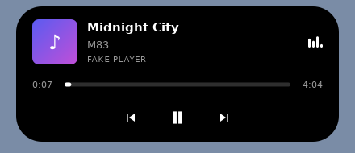

# Islet

Isla dinámica (estilo iPhone) para el escritorio Linux, con controles multimedia.
Hecha con **Electron + React** y conectada a cualquier reproductor mediante **MPRIS (D-Bus)**:
Spotify, VLC, Firefox, Chrome/Chromium, Rhythmbox, Elisa, Lollypop, mpv (con `mpv-mpris`), etc.

<p align="center">
  <br>
  
</p>

## Instalación

### Automática (cualquier distro)

```bash
curl -fsSL https://raw.githubusercontent.com/anrennnn/Islet-Linux/main/install.sh | bash
```

El script detecta tu distro y arquitectura (x86_64 / ARM64), descarga el paquete correcto de la
[última release](https://github.com/anrennnn/Islet-Linux/releases/latest) y lo instala.
En distros sin paquete propio (o sin sudo) instala la versión portable en `~/.local`.
Usa `--portable` para forzarla sin root y `--uninstall` para quitarlo:

```bash
curl -fsSL https://raw.githubusercontent.com/anrennnn/Islet-Linux/main/install.sh | bash -s -- --portable
```

### Manual, según tu distro

Descarga el archivo de [Releases](https://github.com/anrennnn/Islet-Linux/releases/latest) y:

| Distro | Archivo | Comando |
|---|---|---|
| Ubuntu, Debian, Linux Mint, Pop!_OS, Zorin, elementary | `islet-*-amd64.deb` / `arm64.deb` | `sudo apt install ./islet-*.deb` |
| Fedora, Nobara, RHEL, Rocky, AlmaLinux | `islet-*-x86_64.rpm` / `aarch64.rpm` | `sudo dnf install ./islet-*.rpm` |
| openSUSE Tumbleweed / Leap | `islet-*.rpm` | `sudo zypper install --allow-unsigned-rpm ./islet-*.rpm` |
| Arch, Manjaro, EndeavourOS, CachyOS, Garuda | `islet-*.pacman` | `sudo pacman -U ./islet-*.pacman` |
| Cualquier otra (Solus, Void, Gentoo, Slackware…) | `islet-*.AppImage` | `chmod +x islet-*.AppImage && ./islet-*.AppImage` |
| Portable, sin root ni FUSE | `islet-*.tar.gz` | `tar xf islet-*.tar.gz && ./islet-*/islet` (o `install.sh --portable`) |

> **NixOS:** usa `appimage-run islet-*.AppImage`.
> **AppImage / tar.gz en Ubuntu 24.04+:** añade `--no-sandbox` al arrancarlo (AppArmor bloquea el
> sandbox de Chromium fuera de los paquetes del sistema). Si no tienes FUSE, arranca el AppImage con
> `--appimage-extract-and-run`. `install.sh --portable` lo resuelve solo.

## Qué hace

- **Reposo:** píldora pequeña con la hora.
- **Compacta:** carátula + título + ecualizador animado mientras suena algo.
- **Expandida** (al pasar el ratón o al cambiar de canción): carátula, título, artista,
  reproductor, barra de progreso con *seek* y botones anterior / play-pausa / siguiente.
- Elige sola el reproductor que está sonando; desde el menú puedes fijar uno.
- **Clic derecho sobre la isla** (o el icono de la bandeja): reproductor, pantalla
  (multi-monitor), tema (oscuro / claro / cristal), iniciar con el sistema y salir.
- Se inicia sola con el sistema desde la primera vez que la abres (se desactiva en el menú).
- Fuera de la isla los clics pasan a las ventanas de debajo; sin compositor conserva las
  esquinas redondeadas.

## Compatibilidad

| Entorno | Estado |
|---|---|
| X11 (GNOME, KDE, XFCE, Cinnamon, MATE, i3…) | Completo |
| Wayland (GNOME, KDE Plasma, Hyprland, Sway…) | Vía XWayland: la app se relanza sola con `--ozone-platform=x11` |
| Arquitecturas | x86_64 y ARM64 |

En GNOME el icono de bandeja requiere la extensión *AppIndicator*; sin ella usa el clic derecho
sobre la isla. Para forzar Wayland nativo (sin posición fija), arranca con `--ozone-platform=wayland`.

## Desarrollo

```bash
npm install
npm run dev                  # Vite + Electron con recarga
node tools/fake-player.cjs   # reproductor MPRIS falso para probar sin Spotify
```

## Distros probadas

Cada release se instala con `install.sh` en contenedores de estas distros antes de publicarse
(y otra vez después, descargando la release real). La prueba arranca Islet en un X virtual,
comprueba que abre su ventana, que lee un reproductor MPRIS de prueba y que se desinstala limpio:

| Distro | Paquete | x86_64 | ARM64 |
|---|---|:-:|:-:|
| Ubuntu 24.04 / 22.04 | deb | ✓ | ✓ (24.04) |
| Debian 13 / 12 | deb | ✓ | ✓ (12) |
| Linux Mint 22 | deb | ✓ | |
| Fedora 42 / 41 | rpm | ✓ | ✓ (42) |
| openSUSE Tumbleweed / Leap 15.6 | rpm | ✓ | ✓ (Tumbleweed) |
| Arch Linux, Manjaro | pacman | ✓ | |
| Ubuntu 24.04, Fedora 42 | portable (tar.gz) | ✓ | ✓ (Ubuntu) |
| Ubuntu 24.04, Fedora 42 | AppImage | ✓ | ✓ (Ubuntu) |

Además se prueba dentro de escritorios reales: **GNOME (Mutter) y KDE Plasma (KWin) en Wayland**
y **Openbox en X11**. Se comprueba que la isla queda arriba al centro, siempre encima y que en
Wayland se relanza en XWayland. En Openbox una prueba mueve el ratón y pulsa play/pausa, siguiente
y anterior, verificando que el reproductor responde.

Ver [`install-tests.yml`](.github/workflows/install-tests.yml), [`tests/install-test.sh`](tests/install-test.sh),
[`tests/desktop-test.sh`](tests/desktop-test.sh) y [`tests/interaction-test.sh`](tests/interaction-test.sh).

## Publicar una versión

```bash
npm version patch            # o minor / major
git push origin main --tags   # o: Actions → Release → Run workflow
```

La acción [`release.yml`](.github/workflows/release.yml) compila `.AppImage`, `.deb`, `.rpm`,
`.pacman` y `.tar.gz` para x86_64 y ARM64, los prueba en todas las distros de la tabla y solo si
pasan publica la release con `SHA256SUMS.txt` e `install.sh`. Con *publish* desmarcado solo
compila y prueba. [`ci.yml`](.github/workflows/ci.yml) compila y prueba MPRIS en cada push.

## Estructura

```
electron/main.cjs      ventana, bandeja, autoarranque, Wayland→XWayland
electron/mpris.cjs     cliente MPRIS por D-Bus (estado, carátulas, comandos)
electron/preload.cjs   puente seguro hacia React
src/Island.tsx         la isla (reposo / compacta / expandida)
src/styles.css         animaciones y temas
install.sh             instalador que detecta la distro
tests/                 prueba de instalación de extremo a extremo por distro
tools/                 reproductor de prueba y test MPRIS
```

## Licencia

MIT
